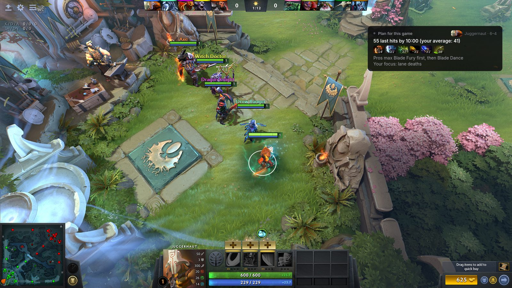
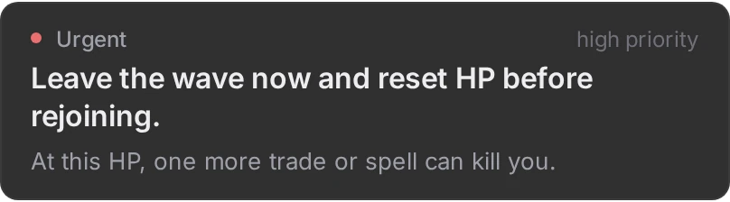
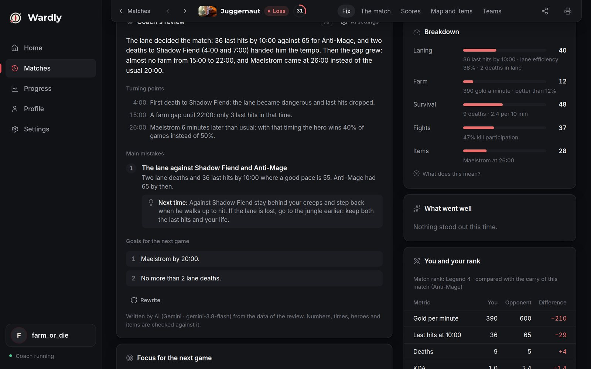
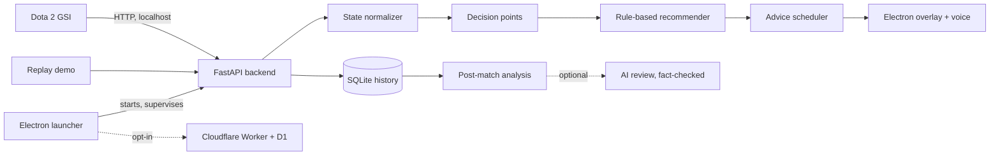

<p align="center">
  
</p>

<h1 align="center">Wardly</h1>

<p align="center">
  <b>A Dota 2 coach that plays every match with you.</b><br />
  Short advice over the game while you play, an honest review after it. Free, local-first, open source.
</p>

<p align="center">
  <a href="https://github.com/makquella/wardly/releases/latest"></a>
  <a href="https://github.com/makquella/wardly/actions/workflows/ci.yml"></a>
  <a href="https://github.com/makquella/wardly/releases"></a>
  <a href="LICENSE"></a>
  <a href="https://t.me/wardlydota"></a>
</p>

<p align="center">
  <a href="https://github.com/makquella/wardly/releases/latest"><b>Download for Windows</b></a> ·
  <a href="https://luhovyimvp.dev/en/?ref=github">Website</a> ·
  <a href="https://luhovyimvp.dev/en/heroes.html?ref=github">64 heroes with full advice</a> ·
  <a href="https://luhovyimvp.dev/changelog.html">What's new</a> ·
  <a href="https://luhovyimvp.dev/privacy.html">Privacy</a>
</p>



## What it does

| During the match | After the match |
|---|---|
|  |  |
| A card over the game (and out loud) at the right moment: low HP, farm pace for your position against this opponent, counter items for the enemy draft, your hero's own saves, skill order, map timers. | A score per area, the three things to fix next game, where you died and why, item timings against your rank, a match map, and an optional AI review where every number is checked against the match data. |

- **Every role.** Full advisor for 64 heroes (carries, mids, offlaners, supports); survival advice for every other hero.
- **Progress over weeks.** Trends, recurring problems, a focus goal tracked match by match, MMR history.
- **Your data stays yours.** History, notes and keys live on your computer. Anything sent anywhere is opt-in and listed on the [privacy page](https://luhovyimvp.dev/privacy.html).
- **Ukrainian and English** in the app, the overlay, the voice and the site.

## How it works

Wardly reads only Valve's official Game State Integration (GSI): Dota posts the visible game state to a local HTTP endpoint. No memory reading, no screen capture, no input automation, no injection.



- **Rules decide, AI only explains.** Live advice comes from deterministic, tested rules: what to say, when, how urgent, and how often. The optional AI writes the post-match review on top of deterministic facts, and its numbers are verified against them.
- **Unknown stays unknown.** GSI shows what you can see. The coach never guesses hidden enemies or team readiness, and it stays quiet when a signal is missing.
- **One local process tree.** The desktop app owns one backend on a free local port, with separate tokens for control and GSI, Origin and Host checks, and bounded request bodies.

More: [Architecture](docs/ARCHITECTURE.md) · [Advice scheduler](docs/ADVICE_SCHEDULER.md) · [Local API security](docs/LOCAL_API_SECURITY.md) · [Desktop security](docs/DESKTOP_SECURITY.md)

## Tech stack

| Part | Stack | Where |
|---|---|---|
| Coach service | Python 3.11, FastAPI, SQLite, pytest, Ruff, mypy (gated baseline) | [`backend/`](backend/) |
| Desktop app | Electron, plain JS (no framework), `node:test` | [`frontend/launcher/`](frontend/launcher/) |
| Cloud (opt-in) | Cloudflare Workers, D1, R2 | [`services/api/`](services/api/) |
| Website | Static HTML generated by Python, no tracking cookies | [`site/`](site/), [`scripts/build_site.py`](scripts/build_site.py) |
| Packaging | PyInstaller + NSIS, auto-update from GitHub Releases | [`docs/PACKAGING_WINDOWS.md`](docs/PACKAGING_WINDOWS.md) |
| Automation | GitHub Actions: CI, Windows build and smoke test, GSI fuzzing, weekly data refresh, release, news | [`.github/workflows/`](.github/workflows/) |

## Repository layout

```text
backend/             FastAPI service: GSI intake, live advice, history, reviews, AI coach
  app/               live pipeline (gsi_state → match_memory → recommender → scheduler) and player history
  tests/             ~1,500 tests: unit, replay regression, real thread and lifespan tests
frontend/launcher/   Electron app: process supervisor, tray, panel, overlay, updater
services/api/        Cloudflare Worker: problem reports, opt-in stats, shared reviews, transfers
site/                luhovyimvp.dev (UK + generated EN, hero pages, news)
scripts/             dev runner, site/news/changelog generators, release and Windows checks
data/                hero profiles, map timers, knowledge base, GSI samples, news posts
docs/                design notes per subsystem, release notes, roadmap
```

## Getting started (development)

Requirements: Python 3.11, Node 22. Windows is the target platform; the backend, the desktop app in dev mode and all tests also run on Linux.

```bash
# backend
cd backend
python -m venv .venv && source .venv/bin/activate
python -m pip install --require-hashes --only-binary=:all: -r requirements-dev.txt

# desktop app: starts its own backend on a free port, the overlay and the tray
cd ../frontend/launcher
npm ci
npm run dev
```

No Dota at hand? The launcher's demo mode replays a recorded match through the real backend and overlay: [Replay demo](docs/REPLAY_DEMO.md).

### Checks

```bash
python scripts/dev.py check --changed --dry-run   # shows what would run for your changes
python scripts/dev.py check --changed             # runs it
python scripts/dev.py check --full                # backend, desktop, Worker, site and version gates
```

CI runs the same gates on every pull request, plus a Windows build that installs the NSIS package and smoke-tests it. Details: [Testing](docs/TESTING.md) · [Dev runner](docs/DEV_RUNNER.md) · [Type checking](docs/TYPE_CHECKING.md).

## Project

- [Roadmap](docs/ROADMAP.md): the long-term goal and the stages toward it.
- [Contributing](CONTRIBUTING.md) · [Security policy](SECURITY.md) · [Code of conduct](CODE_OF_CONDUCT.md)
- [All design notes](docs/README.md) · [Release notes](docs/release-notes/)
- News and the weekly meta: [t.me/wardlydota](https://t.me/wardlydota)

### Code signing policy

The Windows installer is not code-signed yet, so SmartScreen may warn on first run («More info» → «Run anyway»). SignPath Foundation's program for open source has not accepted Wardly yet; we will apply again with a larger audience.

- **Verify a download.** GitHub Actions ([`release.yml`](.github/workflows/release.yml)) builds the installer from this repository at the release commit. The website shows its SHA-256 next to the download button; compare it with `Get-FileHash`. Release notes link a VirusTotal report when one was made.
- **Once signed.** Only the Wardly installer and the app inside it, built from this repository; every signing request approved manually.
- **People.** Committer, reviewer and release approver: [makquella](https://github.com/makquella). Pull requests from anyone else are reviewed before merge.
- **Privacy.** [luhovyimvp.dev/privacy.html](https://luhovyimvp.dev/privacy.html): what the app sends, where, and how to turn it off.

The same policy on the website: [luhovyimvp.dev/code-signing.html](https://luhovyimvp.dev/code-signing.html).

## License

[MIT](LICENSE) © 2026 Artem ([makquella](https://github.com/makquella)).

Dota 2 is a registered trademark of Valve Corporation. Wardly is not affiliated with or endorsed by Valve. Hero and item pictures are Valve's and are loaded from Valve's CDN.
